<!-- ===================== HEADER ===================== -->
<a href="#-featured-projects"></a>

  
  
  
  <!-- Add ResearchGate / Google Scholar / Kaggle badges here once the links are ready -->

  
  

---

## 🧑‍🔬 About Me

I'm an **M.Phil Artificial Intelligence** researcher at **PUCIT, University of the Punjab (Old Campus), Lahore**. My work spans the modern AI stack — from **computer vision and video understanding** to **generative models, multimodal learning and LLM-based systems**.

My way of working is simple: **read the paper → implement the core idea → benchmark it against strong baselines.** That habit runs through my repositories, where CNNs, Vision Transformers, video models and sequence models are put head-to-head on real datasets rather than used as black boxes.

| 🎓 Degree | 🔬 Research Focus | ⚙️ Approach |
|:-:|:-:|:-:|
| M.Phil Artificial Intelligence PUCIT, University of the Punjab | Computer Vision · Generative AI Multimodal Learning · LLMs & RAG | Paper → Implementation → Benchmark → Iterate |

---

## 🚀 Featured Projects

<table>
<tr>
<td width="50%"><a href="https://github.com/RamzanPUCIT/pattern-recognition-early-fusion-har"></a></td>
<td width="50%"><a href="https://github.com/RamzanPUCIT/lhc-legal-information-retrieval-system"></a></td>
</tr>
<tr>
<td width="50%"><a href="https://github.com/RamzanPUCIT/medicinal-leaf-cbir-autoencoder"></a></td>
<td width="50%"><a href="https://github.com/RamzanPUCIT/image-captioning-cnn-lstm"></a></td>
</tr>
<tr>
<td width="50%"><a href="https://github.com/RamzanPUCIT/suspicious-activity-detection-video-models"></a></td>
<td width="50%"><a href="https://github.com/RamzanPUCIT/?tab=repositories"></a></td>
</tr>
</table>

---

## 🔬 Research Areas

<table>
<tr>
<td width="50%" valign="top">

### 👁️ Computer Vision
CNNs vs. Vision Transformers, representation learning and image retrieval.

`ResNet` `ViT` `Swin Transformer` `Autoencoders` `CBIR`

📂 [CNN vs Transformers on Food-101](https://github.com/RamzanPUCIT/food101-cnn-transformer-comparison) · [Medicinal Leaf CBIR](https://github.com/RamzanPUCIT/medicinal-leaf-cbir-autoencoder)

</td>
<td width="50%" valign="top">

### 🎬 Video Understanding & Activity Recognition
Spatio-temporal models for video and multimodal wearable-sensor data.

`VideoMAE` `SlowFast` `I3D` `LSTM` `Transformers` `Sensor Fusion`

📂 [Suspicious Activity Detection](https://github.com/RamzanPUCIT/suspicious-activity-detection-video-models) · [HAR Early Fusion](https://github.com/RamzanPUCIT/pattern-recognition-early-fusion-har) · [Transformer + Positional Encoding](https://github.com/RamzanPUCIT/PR-Level3-Transformer-Positional-Encoding-CogAge)

</td>
</tr>
<tr>
<td width="50%" valign="top">

### 🎨 Generative AI
Diffusion and adversarial models for image restoration and translation.

`DDPM` `Diffusion` `Conditional GAN` `Pix2Pix` `Super-Resolution`

📂 [Face Super-Resolution (DDPM)](https://github.com/RamzanPUCIT/face-super-resolution-diffusion) · [Pix2Pix Image Colorization](https://github.com/RamzanPUCIT/Pix2Pix-Image-Colorization-GAN)

</td>
<td width="50%" valign="top">

### 🔗 Multimodal Learning
Connecting vision and language through contrastive and generative objectives.

`CLIP` `Contrastive Learning` `Image Captioning` `CNN + LSTM`

📂 [CLIP Model Training](https://github.com/RamzanPUCIT/CLIP-Model-Training) · [Image Captioning (Flickr30k)](https://github.com/RamzanPUCIT/image-captioning-cnn-lstm)

</td>
</tr>
<tr>
<td width="50%" valign="top">

### 📚 NLP & Information Retrieval
From classical retrieval to attention mechanisms built from scratch.

`TF-IDF` `Cosine Similarity` `Self-Attention` `Flask`

📂 [LHC Legal Judgment Search Engine](https://github.com/RamzanPUCIT/lhc-legal-information-retrieval-system) · [Scaled Dot-Product Attention (NumPy)](https://github.com/RamzanPUCIT/ai-ml-work-ramzan)

</td>
<td width="50%" valign="top">

### 🤖 LLMs, RAG & Agentic AI
Current focus of study and experimentation alongside my thesis research.

`LLMs` `RAG` `AI Agents` `Hugging Face` `LangChain`

🧪 Active area — new work in progress

</td>
</tr>
</table>

---

## 🔭 Right Now

- 🎓 Conducting **M.Phil thesis research** in Artificial Intelligence at PUCIT
- 🧪 Experimenting with modern architectures — **Vision Transformers, diffusion models and CLIP-style multimodal learning**
- 🤖 Building understanding of **LLMs, retrieval-augmented generation and agentic AI systems**
- 👨‍🏫 **Lab Engineer at the University of Okara** — teaching Data Structures & Algorithms labs in Python ([DSA Lab Manual](https://github.com/RamzanPUCIT/DSA-Lab-Manual))
- 🤝 Open to **research collaborations, AI/ML roles, and PhD / scholarship opportunities**

---

## 🛠️ Toolkit

  

  
  
  
  
  
  
  
  

---

## 🧭 Journey

| | Role | Organization | Period |
|:-:|---|---|---|
| 👨‍🏫 | **Lab Engineer** — Computer Science | University of Okara | Aug 2026 – Present |
| 🤖 | **Machine Learning Intern** | Deep Cognitive Solutions Pakistan, Lahore | Mar 2026 – Jun 2026 |
| 🎓 | **M.Phil Artificial Intelligence** | PUCIT, University of the Punjab — Old Campus, Lahore | 2025 – Present |
| 📖 | **Visiting Lecturer** — Computer Science | ILM College, Renala Khurd | Mar 2025 – Jul 2025 |
| 🎓 | **BS Computer Science** | University of Okara | 2020 – 2024 |

<b>📜 Certifications</b>

 

- **Microsoft Azure AI & Machine Learning** — GSTC Mughalpura, Lahore
- **Python for Everybody Specialization** — Coursera · University of Michigan
- **Python Data Structures** — Coursera · University of Michigan

---

## 📊 GitHub Activity · Live

<table>
<tr>
<td width="50%"></td>
<td width="50%"></td>
</tr>
<tr>
<td width="50%"></td>
<td width="50%"></td>
</tr>
</table>

  <picture>
    <source media="(prefers-color-scheme: dark)" srcset="profile-3d-contrib/profile-night-rainbow.svg" />
    <source media="(prefers-color-scheme: light)" srcset="profile-3d-contrib/profile-green-animate.svg" />
    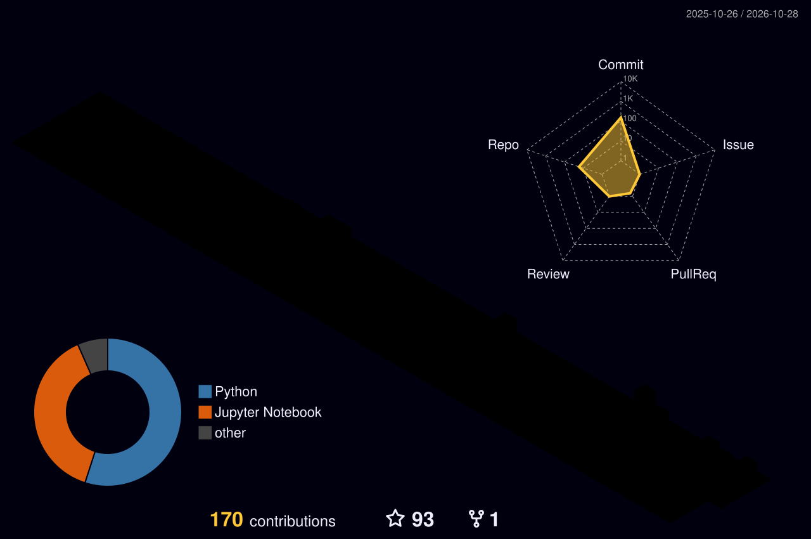
  </picture>

🟢 These cards refresh automatically every hour through GitHub Actions (<code>.github/workflows/profile-3d-contrib.yml</code>).

---

  <b>Always learning, always building.</b> If you're working on computer vision, generative models or LLM systems — let's connect. 🤝

